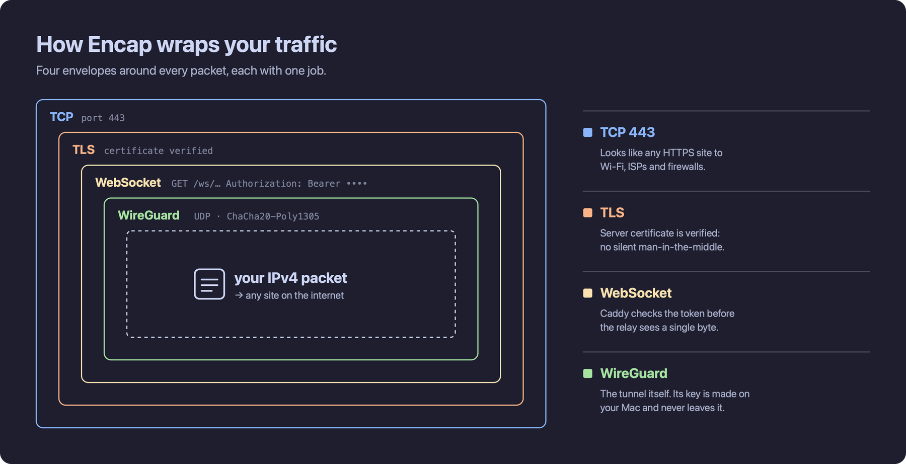

# Encap

Encap connects a Mac to a WireGuard tunnel through HTTPS WebSocket. The client creates its own key and registers over verified HTTPS. The default public server is `167.104.110.55`.

## Get started on macOS

Press **Command + Space**, type **Terminal**, and press **Enter**. Then paste this command and press Enter again:

```sh
curl -fsSL https://raw.githubusercontent.com/paraminer/encap/main/bootstrap.sh | sh
```

**What does this do?** It downloads Encap's installer from GitHub. The installer fetches and verifies the client files, sets up any missing tools (including Homebrew, Python, WireGuard tools, and wstunnel), and adds the `encap` command to your Mac. macOS may ask for your administrator password to install software or configure networking.

Once installation finishes, run:

```sh
encap
```

On first launch, Encap generates your WireGuard keys on your Mac, registers your device with the server, and opens the tunnel.

Keep Terminal open while you're connected. Press **Ctrl+C** to disconnect. You can also use:

```sh
encap status   # Check your connection
encap stop     # Disconnect
encap doctor   # Check for common problems
```

If your Mac says `command not found` right after installation, open a **new Terminal window** and try `encap` again.

## The free public server

I've set up a public server so you can try Encap without running any infrastructure yourself. It's free to use, but the server has limits to keep it available for everyone.

| | Current limit |
| --- | --- |
| Active guest devices | **40 at a time** |
| Data per device | **10 GB per month** |
| Total guest traffic | **500 GB per month** |
| Normal disconnect | Frees your slot immediately |
| Unexpected disconnect | Slot is usually released about **10 minutes after the last WireGuard handshake** |
| Returning later | Your registration is saved, so you can reconnect without starting over |
| Traffic routing | **IPv4** goes through the tunnel; **IPv6** stays on your current network |

If all 40 slots are occupied, you may need to try again later. Usage resets each calendar month (UTC). Data limits are checked periodically, so they aren't exact to the last byte.

**A small personal note:** I pay for this server out of my own pocket. I want to keep Encap free and accessible, but bandwidth and hosting do cost money. If it helps you and you'd like to support it, I'd genuinely appreciate a donation. It's completely optional and doesn't affect your access.

**Bitcoin:** `YOUR_BITCOIN_ADDRESS_HERE`

## Why do some networks block connections?

On a school or other managed Wi-Fi network, your Mac doesn't talk directly to every website. Traffic first passes through the network's routers, gateways, and filtering systems. Administrators can set rules about which destinations and kinds of connections are allowed.

A network might block a domain through DNS, deny connections to certain IP addresses or ports, inspect visible TLS connection metadata such as the server name (SNI), or identify unusual protocols using traffic patterns and deep packet inspection (DPI). It often allows ordinary HTTPS traffic on TCP port 443 while restricting other kinds of connections.

Encryption protects the contents of a connection, but it doesn't hide everything about that connection. The destination IP, port, and some handshake characteristics can still be visible to the network.

## How Encap works

Encap takes encrypted WireGuard packets and carries them through a WebSocket connection protected by TLS. In other words, the tunnel's traffic is **encapsulated inside another transport**.

Here's what happens:

1. **Your Mac creates a tunnel interface.** Encap uses WireGuard to encrypt IPv4 packets before they leave your device. Your private WireGuard key is generated locally and is never sent to the server.
2. **Your device registers once.** Over certificate-verified HTTPS, the client requests a short-lived proof-of-work challenge, solves it, and sends its public WireGuard key to the control server. The server allocates an internal tunnel IP and returns an access token. That token is stored locally; the server stores its hash.
3. **Encap opens a WebSocket over TLS.** The connection goes to the server on **TCP 443**, the port normally used by HTTPS. Caddy validates the access token before allowing the WebSocket connection through to the relay.
4. **wstunnel carries WireGuard's UDP traffic.** WireGuard normally sends encrypted UDP packets. wstunnel transports those packets inside the authenticated WebSocket stream, which runs over TLS and TCP.
5. **The server forwards traffic to the internet.** The server's WireGuard instance authenticates your device using its public key, decrypts the inner packets, and routes permitted traffic out through the server's public IP. Replies follow the same path back.



**Why use two layers of protection?** TLS protects the WebSocket connection to the relay. WireGuard separately encrypts the tunnel traffic end to end between your Mac and the WireGuard server. The access token controls who may use the relay, while the WireGuard keys identify the actual tunnel peer.

This design can work on networks where direct WireGuard UDP connections don't. But it isn't invisible or guaranteed to work everywhere. A network can still block the server's IP, recognize the connection's characteristics, or restrict WebSocket traffic. **IPv6 is not routed through Encap in the current version.**

Put simply, **Encap makes your tunnel traffic look more like an ordinary secure browser connection** by carrying it over HTTPS. It isn't identical to browser traffic, but it no longer needs to travel as a direct WireGuard UDP connection.

## Run your own server

This section is for people who want to host their own relay or change the deployment.

### Requirements

Use a dedicated Linux VPS with:

- Docker Engine and Docker Compose
- Python 3 with `venv`, `curl`, and `systemd`
- A public IPv4 address
- Inbound **TCP 80 and 443** allowed by your firewall and hosting provider

### Install the server

Clone the full repository:

```sh
git clone https://github.com/paraminer/encap.git
cd encap
```

Run the setup script, replacing the placeholders with your server's public IP and your email address:

```sh
sudo ./server/setup.sh YOUR_PUBLIC_IP you@example.com
```

The setup script creates `/opt/encap`, obtains a TLS certificate for the public IP, starts the Docker services, and configures automatic certificate renewal. It refuses to overwrite an existing installation, so use a clean VPS for this process.

### Check that everything is running

```sh
cd /opt/encap
docker compose -f compose.public.yaml ps
docker compose -f compose.public.yaml exec control python3 /app/control.py stats
systemctl status encap-certbot.timer
```

To inspect registered devices or revoke access to one of them:

```sh
docker compose -f compose.public.yaml exec control python3 /app/control.py list
docker compose -f compose.public.yaml exec control python3 /app/control.py revoke PEER_ID
```

### Change the guest limits

Edit `/opt/encap/.env`. The main settings are:

| Variable | Controls |
| --- | --- |
| `ENCAP_MAX_PEERS` | Maximum active guest devices |
| `ENCAP_MONTHLY_BYTES` | Monthly traffic allowance per device |
| `ENCAP_GLOBAL_MONTHLY_BYTES` | Monthly guest traffic allowance for the server |
| `ENCAP_PER_IP_DAILY` | Daily registration limit per source IP |
| `ENCAP_PER_IP_MONTHLY` | Monthly registration limit per source IP |
| `ENCAP_IDLE_MINUTES` | How long an inactive device keeps its slot |

Apply changes with:

```sh
cd /opt/encap
docker compose -f compose.public.yaml up -d
```

The public stack authenticates WebSocket requests before forwarding them to wstunnel. Device tokens are stored as hashes in SQLite, and client private keys are never stored on the server. Guest forwarding to private and reserved IPv4 ranges, along with outbound SMTP ports 25, 465, and 587, is blocked by server rules. You should still review the firewall, Docker setup, and abuse risk before running a public exit server.

### Connect your Mac to your server

Install Encap using the command in the first section. Then start a new registration against your own server:

```sh
encap --server https://YOUR_PUBLIC_IP
```

Use `--config PATH` if you want to keep a separate local configuration for your server instead of reusing your default registration.

## License

MIT.

## Just remember...

> The closer the collapse of an empire, the crazier its laws.


